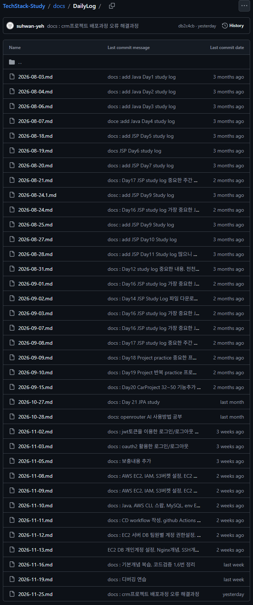
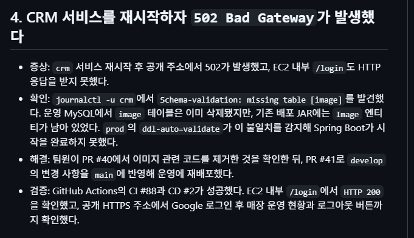
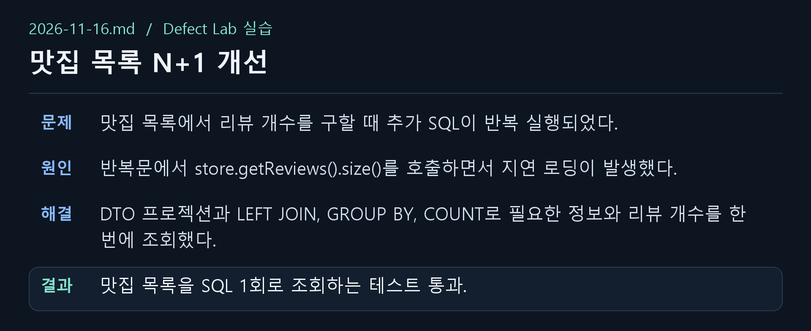
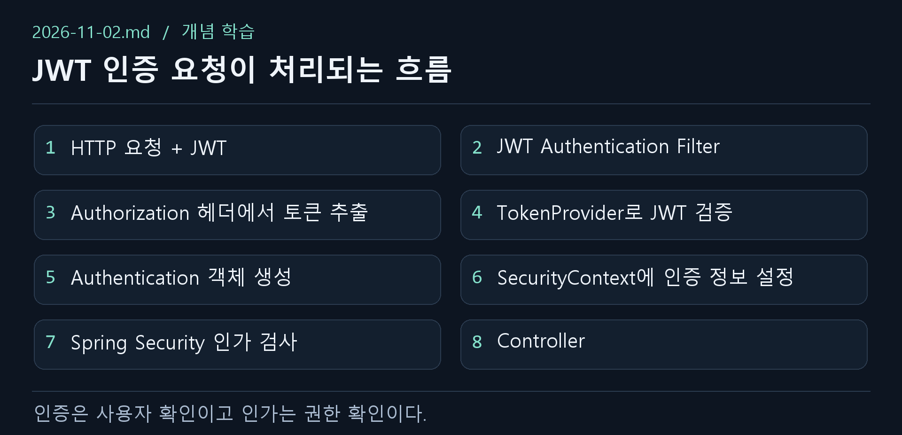

# TechStack-Study

## DailyLog 전체 목록

**2026.08.03 ~ 2026.11.25 · DailyLog 36개 (2026.11.25일 기준) **

Java 기초와 JSP·Servlet부터 Spring Boot·JPA, 인증, AWS 배포까지 날짜별로 기록했습니다. [GitHub에서 전체 파일 목록 열기](docs/DailyLog/)

## 대표 기록

### StoreCRM 배포 후 `502 Bad Gateway` 해결

EC2 서비스 로그에서 Hibernate 스키마 검증 오류를 찾았습니다. 팀원의 수정이 포함된 버전을 재배포한 뒤 `/login`의 HTTP 200 응답과 Google 로그인 완료를 확인했습니다. [11월 25일 운영 기록 읽기](docs/DailyLog/2026-11-25.md)

### JPA N+1 개선과 SQL 1회 검증

Defect Lab 실습에서 맛집마다 반복되던 리뷰 수 조회를 DTO 프로젝션과 `LEFT JOIN` 집계로 합쳤습니다. 테스트에서 목록 조회가 SQL 1회로 끝나는지 확인했습니다. [11월 16일 실습 기록 읽기](docs/DailyLog/2026-11-16.md)

### Spring Security에서 JWT 요청이 처리되는 흐름

HTTP 요청에서 토큰을 읽고 검증한 뒤 `SecurityContext`에 인증 정보를 설정하는 흐름을 정리했습니다. 로그인한 사용자를 확인하는 인증과 접근 권한을 확인하는 인가가 코드에서 언제 일어나는지 복습했습니다. [11월 2일 학습 기록 읽기](docs/DailyLog/2026-11-02.md)

주제별 학습 기록 더 보기

| 주제 | 연결된 기록 |
| --- | --- |
| Java 기초 | [클래스와 객체](docs/DailyLog/2026-08-03.md) · [컬렉션](docs/DailyLog/2026-08-07.md) |
| JSP·Servlet · MVC · JDBC | [회원 등록과 조회 흐름](docs/DailyLog/2026-08-20.md) · [MVC 실습](docs/DailyLog/2026-08-27.md) |
| 브라우저 통신과 디버깅 | [JSON·AJAX·WebSocket](docs/DailyLog/2026-09-08.md) · [브레이크포인트 실습](docs/DailyLog/2026-11-19.md) |
| Spring Boot와 데이터베이스 | [REST API와 JPA](docs/DailyLog/2026-10-27.md) |
| 인증과 인가 | [JWT 인증 흐름](docs/DailyLog/2026-11-02.md) · [Google 로그인 흐름](docs/DailyLog/2026-11-03.md) |
| 배포와 운영 | [EC2 배포 구성](docs/DailyLog/2026-11-11.md) · [StoreCRM 배포 트러블슈팅](docs/DailyLog/2026-11-25.md) |

